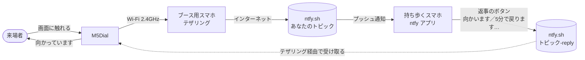

# oyobidashi（お呼び出し）

展示会ブースの「呼び出しボタン」です。出展者がブースを離れているあいだに来場者が M5Dial の画面に触れると、出展者が持ち歩いているスマホに通知が届きます。出展者が通知のボタンで返事をすると、M5Dial の画面に「向かっています」「12:15 ごろ戻ります」と表示されます。

- 費用は 0 円（通知は無料の [ntfy.sh](https://ntfy.sh/)。登録不要）
- 会場に Wi-Fi がなくても、ブースに置いたスマホのテザリングで動きます
- 来場者には画面と音で「ちゃんと呼べた」がすぐ伝わります
- プログラミングの知識は要りません。手順どおりにツールを入れて、設定ファイルに3行書き込むだけです



## 用意するもの

| 機材 | 用途 | 必須 |
|---|---|---|
| [M5Dial](https://docs.m5stack.com/ja/core/M5Dial) | 呼び出しボタン本体（ESP32-S3・丸型液晶・ダイヤル） | ✓ |
| ブースに置くスマホ（Android / iPhone どちらでも） | テザリングで M5Dial をネットにつなぐ | ✓ |
| 持ち歩くスマホ（iPhone / Android どちらでも） | ntfy アプリで通知を受け取る | ✓ |
| モバイルバッテリー（2ポートあると楽） | M5Dial とテザリング用スマホの電源 | ✓ |
| パソコン（Windows / macOS）と USB-C ケーブル | M5Dial にプログラムを書き込む。ケーブルはデータ通信ができるもの | ✓ |
| 3D プリンター | M5Dial を埋め込むプレートとスタンド（`plate/`） | 任意 |

## はじめかた

設定の手順は [docs/setup/](docs/setup/README.md) にまとめています。パソコンとスマホを手元に用意して、上から順に進めてください。

1. [ファームウェアを書き込む](docs/setup/firmware.md)（トピック名の作り方・`secrets.h` の書き方）
2. [ブースに置くスマホのテザリング設定](docs/setup/tethering.md)
3. [通知を受け取るスマホの設定（ntfy アプリ）](docs/setup/receiver-ntfy.md)
4. [当日のチェックリスト](docs/setup/event-checklist.md)

> **秘密情報について**：Wi-Fi のパスワードと ntfy のトピック名は `include/secrets.h` にだけ書きます。このファイルは git の管理対象外です。詳しくは [SECURITY.md](SECURITY.md) を読んでください。

## フォルダ構成

```
call-button/    呼び出しボタン本体のファームウェア（PlatformIO）
battery-test/   モバイルバッテリーの自動オフを確かめるテスト用ファームウェア
plate/          M5Dial を埋め込むプレートとスタンドの 3D モデル（build123d → STEP / STL）
docs/           設定手順（setup/）・UX 仕様（ux-proposal.html）・プレートの設計・開発の記録
tools/          フォント生成・シリアルログ・秘密情報チェックのスクリプト
```

## 自分用に変える

通知の文言、返事のボタン、製品カード、QR コードの行き先は `call-button/src/main.cpp` の先頭にまとまっています。初期値は作者のブース用のサンプル（作者の X アカウントやショップ）が入っているので、自分の SNS やショップに書き換えてください。何も変えなくても呼び出しと返事は動きます。画面の日本語を変えたときはフォントの作り直しが必要です（[firmware.md](docs/setup/firmware.md#画面の文言を変えたとき)）。

## ライセンス

[LICENSE](LICENSE) を参照してください。同梱しているサードパーティのもの（Noto Sans JP から生成したフォントデータなど）は [THIRD_PARTY_NOTICES.md](THIRD_PARTY_NOTICES.md) にまとめています。

## 開発について

このリポジトリは、UI デザイナーの作者が [Claude Code](https://claude.com/claude-code) と対話しながら作りました。開発の経緯や決めたことは [docs/handoff.md](docs/handoff.md)、Claude Code への指示は [CLAUDE.md](CLAUDE.md) に残しています。
