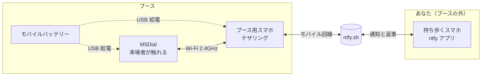
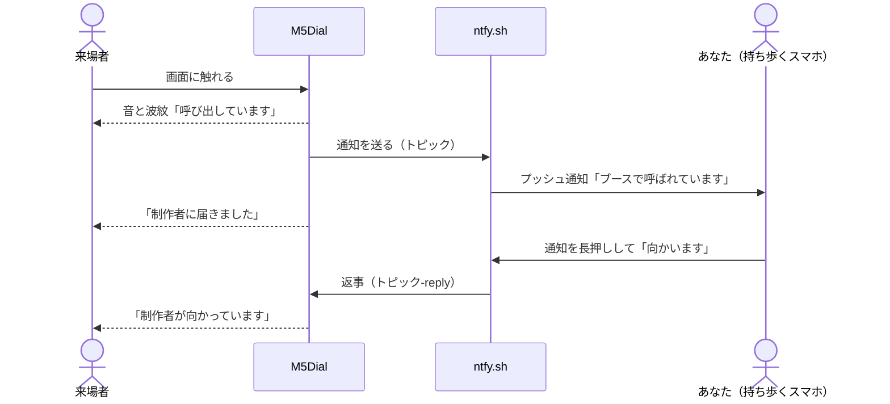

# 設定ガイド

oyobidashi を自分のブースで使えるようにする手順です。

> **ツールを入れずに始めたい人は、[かんたんセットアップ](quick-start.md) へ。** 配布しているファームウェアをパソコンのブラウザで書き込み、スマホから設定します（20分ほど）。
>
> このページから先は、ファームウェアを自分でビルドする（製品カードや画面の文言を変えたい）人向けの手順です。

パソコンとスマホ2台、M5Dial を手元に用意して、上から順に進めてください。

| # | 手順 | かかる時間の目安 |
|---|---|---|
| 1 | [ファームウェアを自分でビルドして書き込む](firmware.md) | 30分（初めて PlatformIO を入れる場合） |
| 2 | [ブースに置くスマホのテザリング設定](tethering.md) | 5分 |
| 3 | [通知を受け取るスマホの設定（ntfy アプリ）](receiver-ntfy.md) | 5分 |
| 4 | [当日のチェックリスト](event-checklist.md) | 会場で5分 |

プログラミングの知識は要りません。ただし、パソコンにツールを入れたり、ファイルの中身を書き換えたりする作業はあります。

## 言葉の説明

| 言葉 | 意味 |
|---|---|
| M5Dial | 丸い画面とダイヤルがついた小さなコンピューター。これが呼び出しボタンになります |
| ファームウェア | M5Dial の中で動くプログラム。パソコンから USB で書き込みます |
| テザリング | スマホを Wi-Fi ルーター代わりにして、ほかの機器をインターネットにつなぐ機能。iPhone では「インターネット共有」 |
| SSID | Wi-Fi のネットワーク名 |
| ntfy（エヌティーエフワイ） | 無料の通知サービス。アプリを入れると、決めた「トピック」に送られた通知を受け取れます |
| トピック | ntfy の通知の宛先の名前。合言葉のようなもので、同じトピック名を知っている人だけが通知を受け取れます |
| PlatformIO | M5Dial などにプログラムを書き込むためのツール。VS Code というエディタに追加して使います |
| 設定モード | M5Dial が一時的に Wi-Fi の親機になり、スマホのブラウザからテザリングやトピック名を設定できる状態。設定がないとき、または画面を押したまま電源を入れたときに入ります |

## 登場する機材と役割

- ブース用スマホと持ち歩くスマホは、別の端末にしてください。持ち歩くスマホでテザリングすると、ブースを離れた瞬間に M5Dial の回線が切れます。
- 3台をつなぐ「合言葉」が ntfy のトピック名です。M5Dial（設定モードか `secrets.h`）と ntfy アプリの両方に同じ名前を入れます。トピック名を知っている人は誰でも通知を読んだり送ったりできるので、推測されにくい文字列にして、人に見せないでください（[SECURITY.md](../../SECURITY.md)）。

## 呼び出しから返事までの流れ

返事がないまま時間がたつと、M5Dial は1分で QR コードを出し、2分で再通知し、5分で「お待たせしています」に切り替えます。

## 秘密情報の置き場所

| 情報 | 書く場所 | git に入るか |
|---|---|---|
| テザリングの SSID・パスワード | M5Dial の設定モード（本体に保存）、または `call-button/include/secrets.h` | 入らない（`secrets.h` は `.gitignore` 済み） |
| ntfy のトピック名 | 同上と ntfy アプリ | 入らない |
| QR コードの行き先 | M5Dial の設定モード、または `call-button/src/main.cpp` | `main.cpp` に書いたものは入る |
| それ以外（文言・時間・色など） | `call-button/src/main.cpp` | 入る |

設定モードで保存した値は、`secrets.h` や `main.cpp` に書いた値より優先されます。
